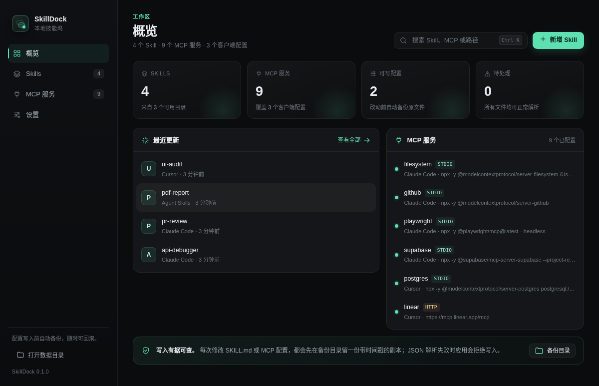
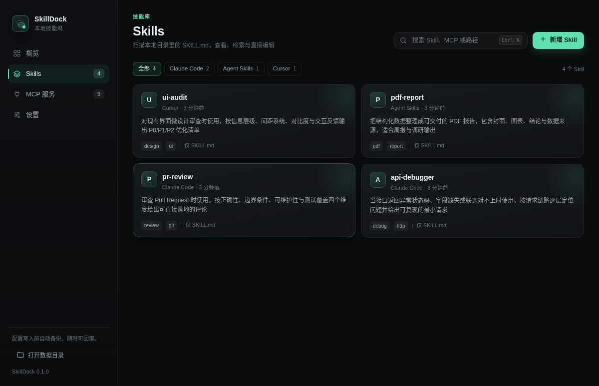
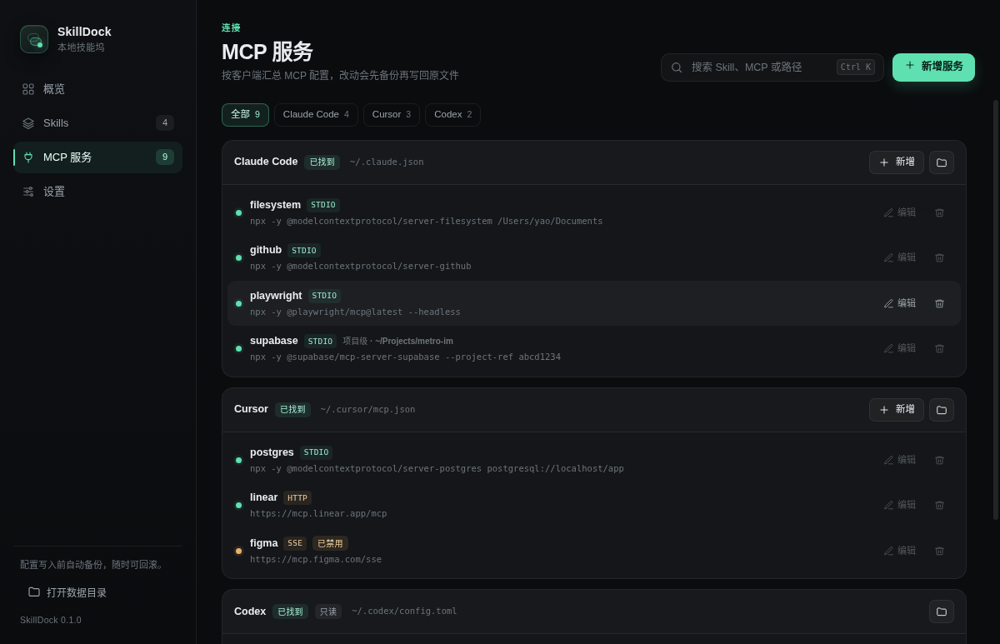

# SkillDock · 技能坞

一个跑在本地的 **Skill 与 MCP 管理器**：把散落在 Claude Code、Claude Desktop、Cursor、Codex、VS Code 里的技能目录和 MCP 配置收拢到一个桌面客户端里，查看、检索、编辑、新增，改完直接写回原文件。

所有读写都发生在本机，不联网、不上传、不带遥测。




## 功能

**Skills**
- 扫描多个来源的 Skill 目录，识别一级或二级子目录里的 `SKILL.md`
- 解析 frontmatter 的 `name` / `description` / `version` / `tags`，缺失时回退到标题和首段
- 按来源筛选、全局搜索（名称 / 描述 / 路径 / 标签）
- 右侧详情抽屉预览正文，支持直接编辑 `SKILL.md`
- 在所选目录下新建 Skill，自动生成带 frontmatter 的模板




**MCP**
- 汇总各客户端配置：Claude Code（含 `projects.*.mcpServers` 项目级条目）、Claude Desktop、Cursor、Codex、VS Code，以及手动添加的任意配置文件
- 识别 `stdio` / `http` / `sse`，展示启动命令、参数、URL、环境变量与禁用标记
- 新增 / 编辑 / 删除服务，写回原 JSON 文件；改名会移除旧键，切换传输方式会清理失效字段
- Codex 的 TOML 只做只读解析，避免写坏格式




**设置**
- 管理 Skill 目录与 MCP 配置文件，显示「已找到 / 未找到 / 解析失败」
- 一键重新扫描，打开数据目录、备份目录
- 自动记住上次停留的视图

## 快速开始

要求 Node.js 20+（开发时使用 Node 22 验证）。

```bash
cd skilldock
npm install
npm start
```

想先看看效果、不想动真实配置，用内置演示数据：

```bash
npm run demo
```

打包（在对应系统上执行）：

```bash
npm run dist:mac   # release/ 下产出 dmg + zip
npm run dist:win   # release/ 下产出 nsis 安装包
```

macOS 首次打开未签名应用时，右键选择「打开」。图标已放在 `build/icon.png`，electron-builder 会自动转成 icns / ico。

## 默认读取的路径

Skill 目录：

| 来源 | 路径 |
| --- | --- |
| Claude Code | `~/.claude/skills` |
| Agent Skills | `~/.agents/skills` |
| Codex | `~/.codex/skills` |
| Cursor | `~/.cursor/skills` |
| Doubao 内置 | `~/.doubao/agent_mode/workspace/.skills` |
| Doubao 用户技能 | `~/.doubao/agent_mode/workspace/.user_skills` |

MCP 配置文件：

| 客户端 | 路径 | 格式 |
| --- | --- | --- |
| Claude Code | `~/.claude.json`（读取根级 + `projects` 下的 `mcpServers`） | JSON |
| Claude Desktop | `~/Library/Application Support/Claude/claude_desktop_config.json` | JSON |
| Cursor | `~/.cursor/mcp.json` | JSON |
| Codex | `~/.codex/config.toml`（`[mcp_servers.*]`，只读） | TOML |
| VS Code | `~/.vscode/mcp.json`（`servers` 字段） | JSON |

路径不存在时不会报错，会以「未找到」呈现；可以在设置里换成任意实际路径。服务字段名支持 `mcpServers` / `servers`，JSON 里已有哪个就写哪个。

## 写回与安全

- **先备份再写入**：每次保存 `SKILL.md` 或 JSON 配置，都会先复制一份到用户数据目录的 `backups/`，文件名带时间戳，最多保留 60 份。
- **原子写入**：先写临时文件再 `rename`，避免中途失败留下半个文件；原文件的权限位会保留。
- **格式保护**：沿用原文件的缩进（两空格 / 四空格 / Tab）；JSON 解析失败时拒绝写入并提示，不会覆盖。
- **范围受控**：只能写设置里登记过的配置文件；Skill 只能写扫描缓存中的 `SKILL.md`，不会碰目录里的其他内容。
- **不联网**：渲染层没有网络请求，外链只有用户点击时才交给系统浏览器打开。

备份位置在「设置 → 数据与备份」里可以直接打开。

## 使用要点

- `⌘K` / `Ctrl K` 聚焦搜索框，`⌘N` / `Ctrl N` 新建 Skill 或 MCP 服务。
- MCP 服务行右侧的「编辑 / 删除」在鼠标悬停时出现；TOML 配置显示为「只读」。
- 配置里标了 `disabled: true` 或 `enabled: false` 的服务会显示「已禁用」，应用只展示该标记，不会替你改动它。
- 删除 Skill 文件不在本次范围内，避免误删目录；需要的话直接在 Finder 里操作。

## 目录结构

```
skilldock/
├── src/
│   ├── main/            # Electron 主进程
│   │   ├── main.js      # 窗口、菜单、IPC、截图/测试钩子
│   │   ├── settings.js  # 默认路径与设置持久化
│   │   ├── skills.js    # SKILL.md 扫描、frontmatter 解析、创建与保存
│   │   ├── mcp.js       # 多客户端 MCP 配置解析与 JSON 写回
│   │   └── backups.js   # 备份、原子写入
│   ├── preload/         # contextBridge 暴露的白名单 API
│   └── renderer/        # 无构建步骤的界面（HTML/CSS/JS）
├── scripts/
│   ├── test-core.js     # 主进程模块的集成测试
│   └── e2e-ui.js        # 真实界面交互链路测试
├── fixtures/home/       # 演示用假配置，不含真实密钥
├── build/icon.png
└── docs/screenshots/    # 界面截图
```

## 开发与测试

```bash
npm test        # 扫描、解析、创建/保存、MCP 增删改、非法 JSON、TOML 只读
```

界面交互测试在 Linux 无头环境下运行（macOS 可直接 `npm start` 手测）：

```bash
TMPHOME=$(mktemp -d) && cp -R fixtures/home/. "$TMPHOME"
SKILLDOCK_HOME="$TMPHOME" SKILLDOCK_E2E=1 xvfb-run -a electron . --no-sandbox
```

测试覆盖：打开 Skills → 新建 Skill → 打开详情 → 编辑保存 → 新增 HTTP MCP → 删除，并校验磁盘上的 `SKILL.md` 与备份目录。

## 已知边界

- 只解析 `SKILL.md`（大小写两种文件名），不解析任意 markdown 规则文件。
- Codex 的 TOML 配置只读；如需编辑请手动改文件。
- 新建 MCP 时写入目标客户端配置的全局级；项目级条目可以编辑和删除，但不能在应用里「挪」到另一个项目。
- 没有实现 MCP 服务的启动探测（拉起进程、拉工具列表）；状态只反映配置文件里是否存在与是否被标记禁用。
- 未配置签名与公证，分发给他人时需自行处理 Apple Developer 证书。

## 许可

[MIT](LICENSE) © 2026 yaoyao0205
